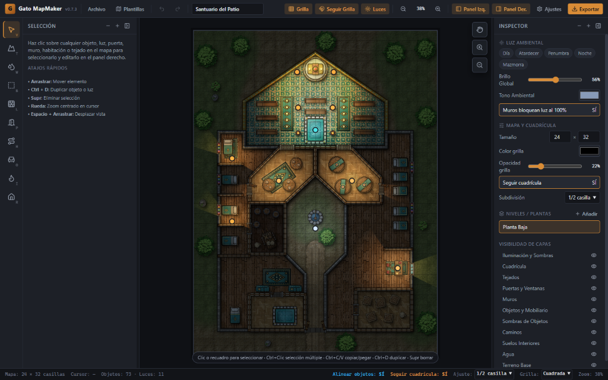
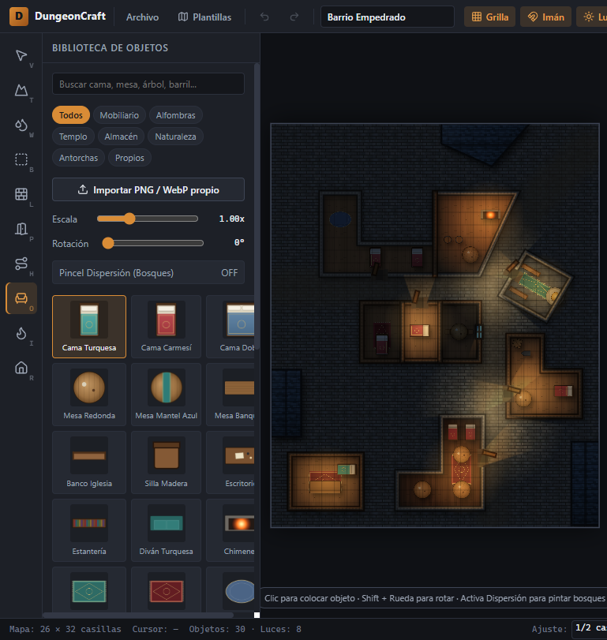
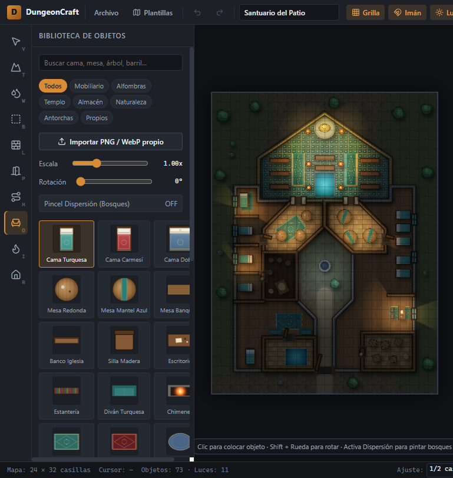

# Gato MapMaker (`v0.7`)

Editor de mapas tácticos para juegos de rol de mesa (D&D, Pathfinder, etc.) inspirado en el flujo de trabajo de **Dungeondraft**, ejecutándose directamente en el navegador con guardado automático local e iluminación dinámica con sombras en tiempo real.

🌐 **Usar online ahora:** https://izukas017.github.io/gato-mapmaker/

📦 **Historial de versiones:** https://github.com/Izukas017/gato-mapmaker/releases

---

## Capturas de pantalla

> Las capturas son de una versión anterior: las texturas actuales son distintas.

### Santuario del Patio (Templo e iluminación con sombras)


### Barrio Empedrado (Distrito urbano con tejados y faroles)


### Biblioteca de Objetos y Mobiliario


---

## Características principales

### Herramientas

| Tecla | Herramienta | Qué hace |
| --- | --- | --- |
| `V` | **Selección** | Mover, rotar, escalar, duplicar, borrar y editar. Arrastra para seleccionar con un recuadro cualquier elemento visible; las capas ocultas no se seleccionan. |
| `T` | **Terreno** | 16 materiales sin costuras con pincel de varias formas, tamaño, opacidad y suavidad. |
| `W` | **Agua** | Pintura continua con orilla automática, agua profunda opcional y modo borrador. |
| `B` | **Edificios y suelos** | Salas rectangulares o poligonales con 18 suelos y muros perimetrales. |
| `L` | **Muros libres** | Trazado poligonal con 12 estilos que bloquean la luz. |
| `P` | **Puertas y ventanas** | 10 tipos que encajan sobre los muros; las abiertas y las ventanas dejan pasar la luz. |
| `H` | **Caminos y senderos** | 15 estilos (tierra, calzada, puentes, vías, arroyos, lava, vallas, alfombras, setos…) con vista previa. |
| `O` | **Objetos** | 299 objetos vistos desde arriba, pincel de dispersión e importador de imágenes propias (`.png` / `.webp` / `.svg`). |
| `I` | **Iluminación dinámica** | Visibilidad 2D con sombras proyectadas por los muros y preajustes de luz ambiental. |
| `R` | **Tejados** | 8 estilos con cumbrera y sombra. |

### Edición

- **Fusionar y Separar:** con 2 o más elementos seleccionados, une las salas, tejados, muros y caminos que se tocan, iguala las propiedades compartidas y agrupa el resto.
- **Caminos:** los del mismo estilo se unen al cruzarse. Con *Curva Suavizada* activada se ajusta la **curvatura**; desactivada, se curva cada tramo arrastrando sus puntos.
- **Luz automática:** antorchas, braseros, hogueras, hornos, cristales y otros objetos luminosos ya emiten luz al colocarlos (20 objetos).

### Biblioteca de objetos

| Categoría | Nº | Categoría | Nº |
| --- | --- | --- | --- |
| Animales y criaturas | 145 | Templos y criptas | 11 |
| Casas y mobiliario | 21 | Vallas y cercados | 10 |
| Pueblo y aldea | 17 | Mazmorras y trampas | 9 |
| Almacén y forja | 14 | Magia y alquimia | 8 |
| Naturaleza y bosques | 14 | Campamentos y viaje | 8 |
| Baño y aseo | 13 | Alfombras y tapices | 8 |
| Tabernas y cocinas | 7 | Iluminación y fuego | 8 |
| Tiendas y comercio | 6 | | |

### Además

- **Guardado automático:** al abrir la página se carga el último mapa que estabas editando.
- **Plantillas incluidas:** *Santuario del Patio* y *Barrio Empedrado*, desde **Plantillas** en la barra superior.
- **App instalable (PWA)** con controles táctiles.
- **Rendimiento:** el mapa se guarda como imagen mientras te mueves, para que el zoom y el desplazamiento vayan ligeros en equipos modestos.
- **Exportación:** **PNG** o **WebP** (70 / 100 / 140 px por casilla), **Universal VTT (`.dd2vtt`)** con muros, puertas y luces para Foundry VTT / Roll20, o proyecto editable `.ddraft.json`.

---

## Atajos de teclado

| Atajo | Acción |
| --- | --- |
| `V` `T` `W` `B` `L` `P` `H` `O` `I` `R` | Cambiar de herramienta |
| `S` | Activar o desactivar el ajuste a la cuadrícula |
| `Esc` | Soltar la selección, el trazo en curso y la herramienta |
| `Enter` | Terminar el muro, camino, sala o tejado en curso |
| `Ctrl + Z` / `Ctrl + Y` | Deshacer / Rehacer |
| `Ctrl + C` / `Ctrl + V` | Copiar / Pegar |
| `Ctrl + D` | Duplicar la selección |
| `Ctrl + Clic` | Selección múltiple |
| `Supr` / `Retroceso` | Eliminar la selección |
| `Shift + Rueda` | Rotar el objeto antes de colocarlo |
| `Espacio + Arrastrar` / `Clic derecho` / `Rueda` | Desplazar la vista |
| `Ctrl + Rueda del ratón` | Zoom centrado en el cursor |

---

## Desarrollo local

```bash
npm install
npm run dev
```

Compilar y ejecutar tests:

```bash
npm run build
npm test
```
